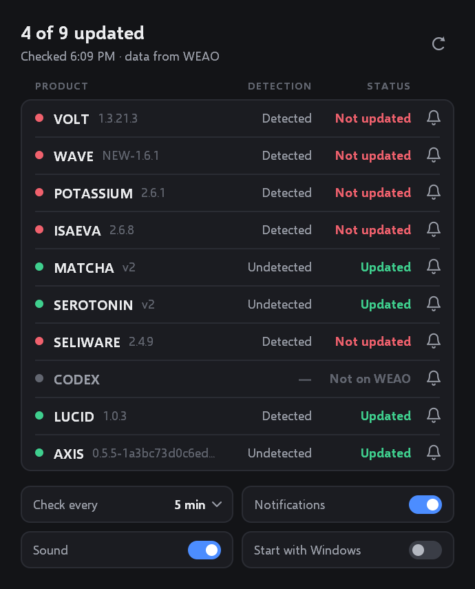

# RoCheats Monitor

A small Windows tray app. It watches ten products through the public WEAO API
and raises a Windows notification when one of them changes status.



## Run it

`RoCheatsMonitor.exe` is self-contained: no installer and nothing else to
download. It needs 64-bit Windows 10 or 11.

The exe is not code-signed, so the first launch shows "Windows protected your
PC". Choose **More info**, then **Run anyway**.

## What the window shows

- One row per product: update status, Hyperion detection, and the version WEAO lists.
- **Updated** is what the RoCheats status post calls "Working"; **Not updated** is "Down".
- Updated does not mean undetected. The Detection column is separate for that reason.
- The bell on each row switches alerts for that product on or off.
- The bottom row sets the check interval (1 to 30 minutes, 5 by default),
  notifications, sound, and start with Windows.
- The refresh button or F5 checks immediately.
- CODEX is not listed by WEAO, so its row says "Not on WEAO". If WEAO adds it,
  the row starts working without any change.

## Tray

Closing the window leaves the app running in the notification area. Windows may
tuck the icon behind the `^` arrow; drag it onto the taskbar to keep it visible.

- Click the icon to open the window.
- Right-click it for **Check now**, **Send test notification** and **Exit**.

## Notifications

An alert is raised only when a status that was already known changes, so the
first run and restarts are silent.

Windows decides how alerts are displayed. Do Not Disturb hides the banners and
sends them to the notification centre instead, and Windows 11 switches it on by
itself during full-screen games (Settings > System > Notifications).

## Settings

Everything is stored in `%APPDATA%\RoCheatsMonitor\settings.ini`, including the
last known statuses.

- To track other products, close the app and edit the `Products=` line. Use the
  names shown on <https://weao.xyz>, separated by commas, 16 at most.
- To reset, delete the `RoCheatsMonitor` folder.
- "Start with Windows" adds one value named `RoCheatsMonitor` under
  `HKCU\Software\Microsoft\Windows\CurrentVersion\Run`. Switching it off removes it.

## Network

Each check is one request: `GET https://weao.xyz/api/status/exploits`, with the
`WEAO-3PService` user agent that WEAO asks third-party tools to send. If that
host is unreachable it tries `whatexpsare.online`, then `weao.gg`. The app
contacts nothing else.

## Build from source

```
sudo apt install g++-mingw-w64-x86-64 python3-pil    # Debian or Ubuntu
./build.sh
```

| File | Contents |
|---|---|
| `src/main.cpp` | The whole application |
| `src/json.h` | JSON reader |
| `res/` | Icon, manifest and version resource |
| `tools/make_icon.py` | Generates `res/app.ico` |

`preview.png` was captured in a test environment at 150% scale with the title
bar cropped off, using a stand-in for the Segoe UI font.
